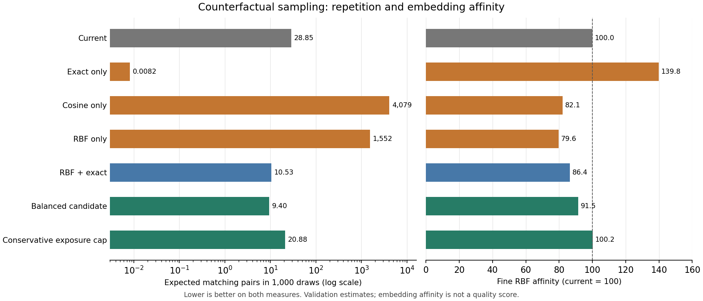

# Sampling balance study — 2026-10-30

Combining an exact-repeat penalty with embedding affinity improved both measured
objectives. Optimizing either alone produced substantial failure modes. These are
counterfactual weights; no family, payload, or compiled weight was changed.

The study used source revision `e180dd3748ba73dc959b098d40ef1466db10b45c`:
844 leaves, 622 corpora containing 89,895 records, and 222 generators. All corpus
texts are distinct, including after NFKC normalization, case folding, and whitespace
collapse. Baseline corpus-only collision probability is exactly
`0.000051525729210813`. Independent generator banks raise the estimated total to
`0.0000573109` on train and `0.0000577499` on validation. Raw and normalized
collision estimates agree on these banks.

Each generator supplied 512 seeded draws per split. Semantic banks have 33,532
rows each, at most 64 per leaf. Small corpora are enumerated in both banks;
larger corpora use disjoint uniform subsets. The 6,283 enumerated corpus records
shared between banks are exact finite-population information, not heldout tests.
Generator seeds are disjoint across splits. Every leaf retains its actual
probability through weighted quadrature; catalog size does not set its root mass.
The source/binary check matched all 844 leaf probabilities, 5,661 embedded corpus
texts, and 222 direct seeded generator outputs.

Embeddings use `microsoft/harrier-oss-v1-0.6b`, revision
`f9b9dc8d367d443f2479d27aa5d8d2850c0774ee`, `similarity` input mode, no instruction,
1,024 dimensions, float16 model computation with high precision enabled, and
float32 stored vectors. No rows were rejected or
truncated. Train-only calibration sets RBF bandwidths to
`0.405986`, `0.609720`, and `0.790780`; RBF calculations use 16 representative rows
per leaf. Cosine uses the full bank. People, cars, animals, and subdivisions retain
their existing internal count-weight ratios in every experiment.

The mixed objective is `0.5 E/E₀ + λ C/C₀ + τ KL(p || p₀)`, where `E` is the
average of three RBF affinities and `C` is exact-text collision probability.
Strengths depend on this baseline scaling. Optimization uses PSD empirical
V-statistic RBF matrices. Reported affinities correct their diagonals for finite
sampling; generator repetition uses distinct-draw U-statistics. A zero observed
collision is an estimate, not proof of an infinite output space.

The table reports validation estimates. Matching pairs are the expected number of
equal-text pairs among 1,000 independent root draws, not the number of repeated
draws. Lower affinity means less similarity under this embedding model. Effective
leaves is `1 / Σp²`; total variation (TV) is the fraction of probability mass moved.

| Variant | Matching pairs / 1k | Fine RBF index | Effective leaves | TV |
| --- | ---: | ---: | ---: | ---: |
| Current | 28.85 | 100.0 | 226.0 | 0.000 |
| Exact only | 0.0082 | 139.8 | 66.6 | 0.854 |
| Cosine only | 4,079 | 82.1 | 23.8 | 0.918 |
| RBF only | 1,552 | 79.6 | 35.8 | 0.900 |
| RBF + exact, λ=.03 | 10.53 | 86.4 | 79.6 | 0.689 |
| RBF + exact + KL, λ=.03, τ=.03 | 9.40 | 91.5 | 204.5 | 0.321 |
| Minimum KL, training-observed atom cap | 20.88 | 100.2 | 226.5 | 0.030 |



The [28-variant summary](balance-study-summary.csv) also retains medium/broad
scores, document-mode rescoring, maximum output masses, and solver success.

Pure semantic optimization increased exact repetition about 54–141 times. This
was not promotion of random noise: UUID mass fell to effectively zero. It promoted
small, distinctive corpora. Cosine assigned 5.40% root mass to the single Doyle
paragraph, previously 0.000325%. In the 80-output RBF stream, the Alice opening
appeared three times, and a Doyle paragraph and torque formula each repeated.
Weighted mean output length rose from 321 to 515 characters, while the median
fell from 159 to 140: both long excerpts and terse fixed snippets benefited.
Exact-only optimization instead removed almost all corpus mass and increased
random-family mass from 1.96% to 21.77%.

The λ=.03, τ=.03 mixture reduced estimated exact pairs 67.4%, fine affinity 8.55%,
medium affinity 3.79%, and broad affinity 2.25%, while retaining 204.5 effective
leaves. Its inspected 80-output stream had 80 distinct texts across 22 families,
including ordinary names, places, source passages, music, and technical artifacts.
No obvious noise promotion appeared, although multiple SQL outputs remained
structurally similar. This moves 32.1% of leaf mass and 21.3% of family mass.
People receive 9.86%, literature 9.06%, and geography 8.44% instead of 3.92% each.

The minimum-KL cap moved only 3.03% of mass and reduced estimated exact pairs
27.6%, with a 0.17% increase in fine affinity. It caps known corpus atoms and
empirical training generator atoms at 0.02451% root probability. Validation's
largest observed atom reaches 0.03431%, so this is not a universal generator
exposure guarantee. A corpus-only quarter-cap gave a 25.5% repeat reduction.

Geometry needs qualification. Median cosine is 0.872 within leaves and 0.687
across leaves. Several neighbors were sensible, such as aspartic/asparagine
profiles; others followed notation, such as UTF-8 tables near ABC music. Synthetic
ASCII, digits, and hexadecimal controls were *more* similar to the baseline than
actual leaf means in similarity mode. Noise isolation was not the observed trap.
Matched 16-row document-mode rescoring reduced the λ=.03, τ=.03 mixture's fine
gain to 3.56%, medium to 1.71%, and broad to 0.83%; all remained improvements.
Cosine-only became worse than baseline on document-mode fine affinity.

A final check rescored six fixed candidates against all 33,532 validation rows,
without refitting or changing bandwidths. The balanced candidate's fine gain
changed from 8.55% to 8.49%, medium from 3.79% to 3.76%, and broad from 2.25% to
2.24%. All improvement directions survived; fine and medium rankings were
unchanged. Full results are in `target/balance-study/full-validation-rescore.json`.

Baseline targets for focused content work differ from semantic outliers:

- Norse Edda has 18 records and contributes `5.34e-6` to corpus collisions, the
  largest leaf contribution. Expand with complete source units or lower exposure.
- Torque has two records and the hottest individual corpus atom, 0.0980% root
  probability; its total contribution is `1.92e-6`. Adjust exposure before adding
  cosmetic numeric variants.
- Syllogisms contribute an estimated `2.19e-6` on validation, with 164 distinct
  outputs in 512 draws. Treat this generator as a finite construction when balancing.

All 28 solutions conserve probability, preserve the four locks, and satisfy their
declared caps/envelopes within `1e-9`; all solver statuses succeeded. Nine focused
fixtures cover finite-population correction, duplicate identities/representation,
collision estimates, locks, conservation, and analytic optima. The optimized raw
RBF matrix has minimum eigenvalue `+0.009295`; corrected RBF alone has `-0.009790`
and its sensitivity run is a local SLSQP solution. Adding the tested exact penalty
makes that particular corrected mixed matrix PSD; convexity is checked per objective.

Validation was used to compare 28 variants, not reserved as a pristine final test.
Two seed banks do not provide distribution-free confidence intervals. No blinded
human quality study was performed. The next useful test is a blinded comparison
of current, the conservative observed cap, and λ=.03/τ=.03, with explicit editorial
decisions about family shares before applying weights.

Reproduce from the repository root with Python, NumPy, SciPy, requests, and
CVXPY with Clarabel/OSQP. This run used NumPy 1.26.4, SciPy 1.16.2, CVXPY 1.7.2,
Clarabel 0.7.0, and OSQP 1.0.4. CVXPY is optional in the script; SLSQP is the fallback.
The embedding endpoint defaults to `http://noesis.internal:8088` and must expose
the pinned model. Fresh collection uses seed `20261030`; geometry uses `718203`.

```sh
cargo build --release --locked
python -B scripts/balance_sampling.py --binary target/release/inspire.exe
python -B scripts/balance_embeddings.py target/balance-study/train.jsonl target/balance-study/validation.jsonl
python -B scripts/balance_geometry.py
python -B scripts/balance_experiments.py --study target/balance-study
python -B -m unittest discover -s scripts -p test_balance_study.py
```

For the matched mode check, repeat embeddings with `--output
target/balance-study/document-mode --input-type document --cap-per-leaf 16`, run
geometry with `--root target/balance-study/document-mode`, then run
`python -B scripts/balance_geometry.py --rescore-modes`. Full bank hashes, weights,
kernel matrices, seeded streams, and diagnostics remain under `target/balance-study/`.
